# PanzerCity

숄더뷰 3인칭 시점의 아케이드 탱크 슈팅 게임입니다. 게임 프로그래밍 교육 과정 중 기획부터 구현까지 혼자 진행한 개인 프로젝트로, **Steam에 무료로 출시되었습니다.** 싱글플레이어와 최대 4인 협동 멀티플레이어를 모두 지원하고, PC 조작과 모바일 터치 조작을 모두 구현했습니다.

| 플랫폼 | 상태 |
| --- | --- |
| Steam | 출시 ([스토어 페이지](https://store.steampowered.com/app/5299150/PanzerCity/)) |
| Android (Google Play) | 출시 준비 중 |

> 이 저장소는 전체 Unity 프로젝트 중 스크립트(C#) 폴더만 발췌한 코드 샘플입니다.<br>
유료 에셋 등 리소스 파일은 라이선스상 포함되어 있지 않습니다.

## 목차

- [플레이 영상](#플레이-영상)
- [기술 스택](#기술-스택)
- [주요 기능](#주요-기능)
- [게임플레이 구조](#게임플레이-구조)
- [핵심 구현 사항](#핵심-구현-사항)
  - [1. 전차 공통 모듈 설계](#1-전차-공통-모듈-설계)
  - [2. 설정 데이터 관리](#2-설정-데이터-관리)
  - [3. 적 AI 구조](#3-적-ai-구조)
  - [4. 카메라 제어와 조준](#4-카메라-제어와-조준)
  - [5. 멀티플레이어 확장](#5-멀티플레이어-확장)
  - [6. 그리드 인벤토리와 장착 롤백](#6-그리드-인벤토리와-장착-롤백)
  - [7. 오브젝트 풀링](#7-오브젝트-풀링)
  - [8. 세이브와 로드](#8-세이브와-로드)
  - [9. 에디터 툴](#9-에디터-툴)
  - [10. 디버그 기능](#10-디버그-기능)
  - [11. 모바일 환경 대응](#11-모바일-환경-대응)
- [트러블슈팅](#트러블슈팅)
- [멀티플레이어 설계 과정](#멀티플레이어-설계-과정)
- [주요 코드 바로가기](#주요-코드-바로가기)
- [향후 계획](#향후-계획) · [사용한 에셋](#사용한-에셋)

## 플레이 영상

[](https://youtu.be/MnOQQwJs6_s)

*▶ 클릭하면 유튜브에서 재생됩니다*

### 인게임 화면

| | |
| --- | --- |
| 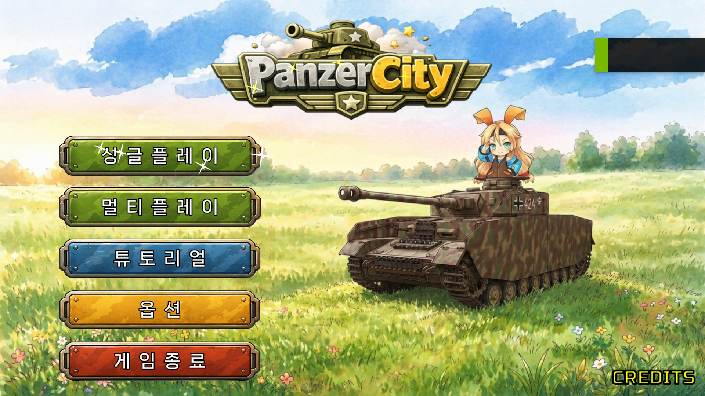 | 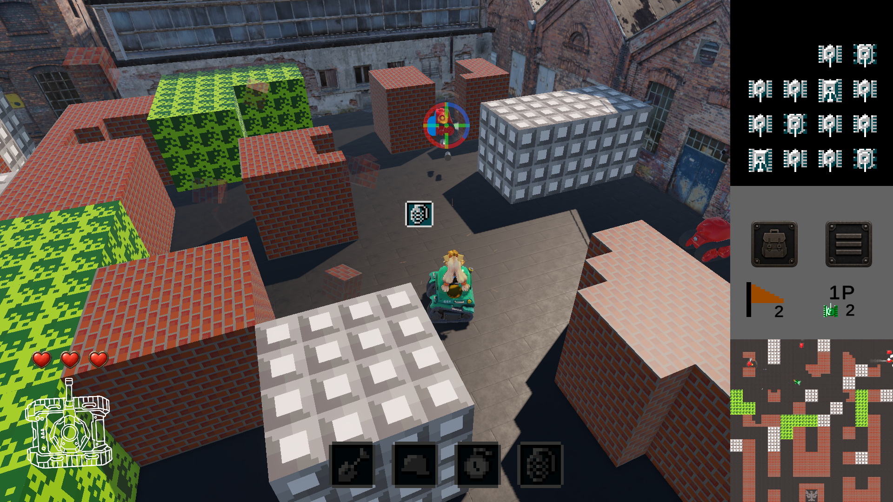 |
| 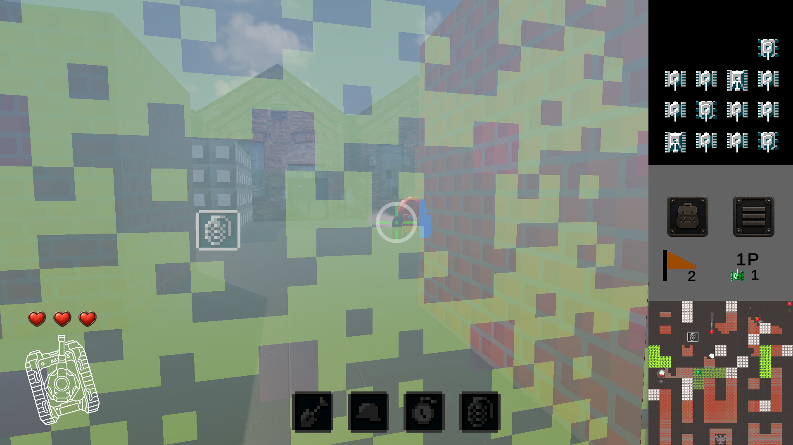 | 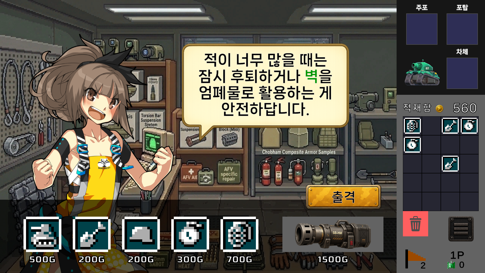 |
| 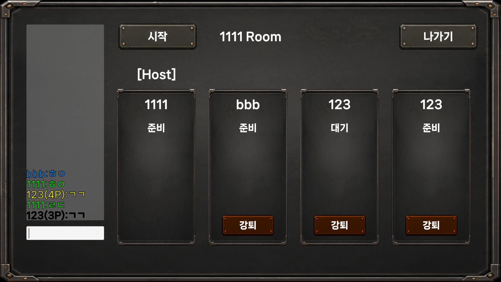 | 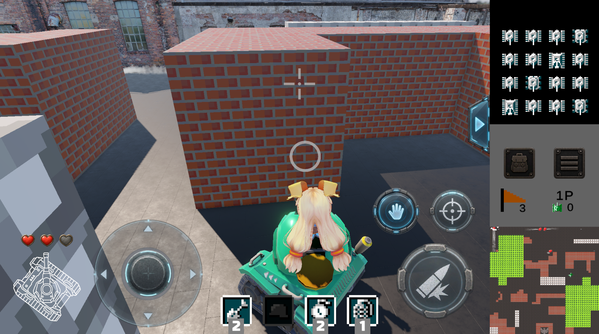 |

## 기술 스택

- Unity 6000.3.7f1 (URP)
- Netcode for GameObjects
- Unity Lobby Service / Unity Relay / Unity Authentication (익명 로그인)
- TextMeshPro
- New Input System (키보드 · 마우스와 모바일 터치 입력 공용)
- Cinemachine
- NavMesh (적 경로 탐색)
- Unity Localization (한국어/영어 지원, 언어별 폰트·폰트 크기 분리 지정)
- Unity Multiplayer Play Mode (에디터 멀티플레이어 테스트)

## 주요 기능

본문에서 다룬 기능을 분류별 키워드로 정리했습니다. 괄호 안 링크를 누르면 해당 설명으로 이동합니다.

**전투 · AI**

- 플레이어 · 적 전차 공통 모듈<br>
— `TankBase` / `TankModel` / `HitZone`, 부위별(정면 · 측면 · 후면) 피격, 폭발 범위 피해 ([상세](#1-전차-공통-모듈-설계))
- 적 AI 상태머신 — 성격 4종, NavMesh 경로 탐색 + 직접 회전 제어, 시야 · 수풀 감지 ([상세](#3-적-ai-구조))
- 적 전차 4종과 스폰 시스템 — 데이터 테이블 기반 스폰 순서 · 간격 · 동시 등장 수 ([게임플레이 구조](#게임플레이-구조))
- 맵 장애물 — 파괴 가능한 벽, 기지 벽, 수풀, 진흙, 물

**멀티플레이어**

- 최대 4인 협동 — Unity Lobby / Relay 연결, 방 목록 · 빠른 시작 · 비밀번호 · 준비 · 강퇴 ([상세](#5-멀티플레이어-확장))
- 싱글플레이어 경로를 건드리지 않는 브릿지 컴포넌트 구조, 서버 권위 판정 + 클라이언트 로컬 재현
- 관전 모드, 전원 사망 판정, 재도전 동기화, 호스트 이탈 처리
- 로비 · 인게임 채팅 (IME 대응), 상점 원격 커서 공유

**인벤토리 · 아이템**

- 그리드 기반 드래그 앤 드롭 인벤토리 (MVP 패턴: `InventoryView` / `ItemView` / `InventoryPresenter`) ([상세](#6-그리드-인벤토리와-장착-롤백))
- 장비 3슬롯 장착 · 해제와 자리가 없을 때의 장착 롤백
- 사용 아이템 5종, 퀵슬롯, 가중치 드랍 테이블
- 상점 시스템 (주인 대사, 동전 날아가는 연출)

**카메라 · 조준**

- Cinemachine 3인칭 / 저격 카메라 전환, FOV 기반 감도 보정, 스크롤 · 핀치 줌 ([상세](#4-카메라-제어와-조준))
- 화면 조준점 보정, 조준한 적 실루엣 하이라이트, 테두리 벽 반투명 교체

**데이터 · 저장**

- JSON 데이터 테이블 + ScriptableObject 기반 아이템 · 장비 설정 + 에디터 임포터 ([상세](#2-설정-데이터-관리))
- 세이브 / 로드 시스템 — 슬롯 6개, 스테이지 시작 시 자동 저장, 이어하기 ([상세](#8-세이브와-로드))
- 옵션(언어 · 음량 · 해상도 · 품질 · 마우스 감도 · 밝기), 한국어 / 영어 로컬라이징

**구조 · 성능**

- 오브젝트 풀링 (Netcode 연동) ([상세](#7-오브젝트-풀링))
- `GameManager`가 리소스 · 풀 · 데이터 · 이펙트 · 오디오 · 옵션 · 세이브 등 매니저를 한곳에서 조합하는 전역 서비스 구조

**도구 · 디버그**

- 에디터 툴 — 수풀 · 물 겹침 최적화, 아이템 임포터, 폰트 일괄 교체 ([상세](#9-에디터-툴))
- 치트 토글, Gizmos 시각화, FPS 카운터, 빌드 중복 실행 방지, 에디터 모바일 테스트 모드 ([상세](#10-디버그-기능))

**플랫폼 대응**

- PC(키보드 · 마우스)와 모바일(터치) 입력을 `InputSystemHandler` 한 곳으로 일원화<br>
— 조이스틱, 룩존, 핀치 줌, 터치 버튼 ([상세](#11-모바일-환경-대응))
- 플랫폼별 UI · 문구 분기 (줍기 힌트 아이콘, 튜토리얼 · 관전 안내 문구)

**연출 · UX**

- 플레이어별 색상 구분 미니맵(확대 토글), HUD 슬라이드인 연출, 피격 방향 표시기, 재장전 인디케이터
- BGM / 사운드 시스템 (풀링되는 3D 효과음, 일괄 처치 사운드 큐잉)

## 게임플레이 구조

### 스테이지 진행

25개 스테이지로 구성되어 있고, 스테이지마다 적 전차 20대가 순차적으로 스폰됩니다.<br>
5스테이지 단위로 스폰 간격이 0.2초씩 짧아지고 동시 등장 가능 수가 1대씩 늘어나며 난이도가 단계적으로 올라갑니다.

| 스테이지 | 스폰 간격 | 최대 동시 등장 |
| --- | --- | --- |
| 1~5 | 2.0초 | 4대 |
| 6~10 | 1.8초 | 5대 |
| 11~15 | 1.6초 | 6대 |
| 16~20 | 1.4초 | 7대 |
| 21~25 | 1.2초 | 8대 |

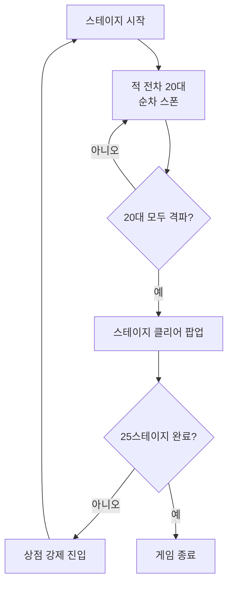

상점은 스테이지 클리어 후 매번 강제로 열리고 건너뛸 수 없습니다. 25번째 스테이지를 클리어하면 상점 없이 클리어 화면(메시지와 플레이 통계)이 표시되며, 별도 보스나 엔딩 연출은 없습니다 — 기획 단계에서는 보스를 넣을 계획이었으나 현재 버전에는 포함되어 있지 않습니다.

### 적 전차 종류

| | 타입 | 특징 |
| --- | --- | --- |
|  | 경전차 | 이동속도·공격속도가 빠릅니다. 직격 데미지는 받지 않고, 폭발 범위에 휘말릴 때만 파괴됩니다. |
|  | 중&#8288;형&#8288;전&#8288;차 | 가장 많이 등장하는 기본형으로, 능력치가 전반적으로 평균입니다. |
|  | 중전차 | 유일하게 HP 4를 가진 적입니다. 이동속도·공격속도는 느리지만, 피격 방향에 따라 데미지가 다릅니다.<br>(정면 1 · 측면 2 · 후면 3) — 측면을 2번 맞으면 격파됩니다. 방향마다 데미지가 달라 체감 체력을 가늠하기 어려운 만큼, 남은 체력에 따라 초록→노랑→주황→빨강으로 색이 바뀌어 알려줍니다. |
|  | 구축전차 | 유일하게 포탑이 없어 차체 전체를 돌려 조준합니다. 포탄 속도가 다른 타입보다 빠릅니다. |

### 행동 패턴

적의 이동 방식은 전차 타입과 별개로 네 가지 성격 중 하나가 지정됩니다(구축전차는 고정형 · 공격형 중에서만 지정됩니다).<br>
성격과 무관하게 모두 배회 상태로 시작하고, 플레이어를 발견하는 순간 성격별로 다른 행동으로 전환됩니다.

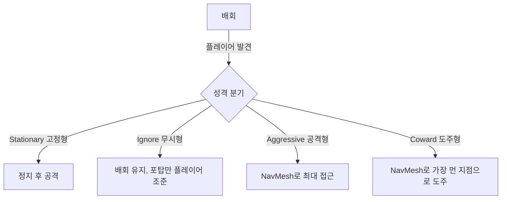

중전차가 Coward로 지정된 경우는 회피 경로로 후진하는 방식으로 구현되어 있습니다.

### 맵 장애물

| | 이름 | 설명 |
| --- | --- | --- |
| — | 테두리 벽 | [`CameraBedrockChange.cs`](https://github.com/gesua/PanzerCity_scripts/blob/main/Camera/CameraBedrockChange.cs) — 맵 외곽을 감싸는 파괴 불가능한 벽. 카메라와 플레이어 사이를 가리면 반투명한 빨간 큐브로 표시되어 시야를 가리지 않습니다.  |
| 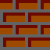 | 파&#8288;괴&#160;가&#8288;능&#8288;한&#160;벽 | [`Wall.cs`](https://github.com/gesua/PanzerCity_scripts/blob/main/Environment/Wall.cs) — 큐브 4개가 쌓인 기둥 단위로 반응합니다. 포탄에 맞으면 그 기둥의 큐브들만 물리 힘으로 흩어지고 5초 뒤 사라집니다. 맵에 배치할 때는 4×4 정사각형으로 묶어서 놓는 편이 편해서 그렇게 배치했습니다. HQ 주변의 기지 벽은 아군 포탄으로는 부술 수 없고, 적 포탄에 부서지면 경고가 표시됩니다.  |
|  | 흰색 벽 | [`BaseWall.cs`](https://github.com/gesua/PanzerCity_scripts/blob/main/Environment/BaseWall.cs) — 파괴 불가능한 벽입니다. 벽 자체는 별도 상호작용이 없는 정적 오브젝트지만, 기지무적 아이템을 사용하면 기지 주변에 이 벽이 생기면서 주변 탱크를 밀어내고 부서진 기지 벽을 복구하며, 종료 시점이 다가오면 깜빡이는 경고로 알려줍니다.  |
|  | 수풀 | [`BushGroup.cs`](https://github.com/gesua/PanzerCity_scripts/blob/main/Environment/BushGroup.cs) — 탱크를 가려주는 은신 지대입니다(포탄은 그대로 통과·명중). LoL의 부쉬처럼, 완전히 들어간 탱크는 바깥에서 보이지 않고, 수풀 안의 플레이어는 같은 수풀에 있지 않은 적이 인식하지 못합니다. 플레이어가 안으로 들어가면 수풀이 반투명해져 안쪽을 볼 수 있습니다.  |
|  | 물 | 바닥에 깔려 있는 지형으로, 탱크가 통과할 수 없는 장애물입니다. |
|  | 진흙 | [`Mud.cs`](https://github.com/gesua/PanzerCity_scripts/blob/main/Environment/Mud.cs) — 바닥에 깔린 감속 지형입니다. 원작에서는 미끄러지는 발판이었지만, 이 프로젝트에서는 밟은 탱크의 이동 속도와 회전 속도를 1/2로 낮추는 방식으로 바꿨습니다.  |

### 아이템 / 장비

5종류의 사용 아이템이 있고, 효과가 미치는 범위에 따라 처리 방식이 나뉩니다.

| 아이템 | 효과 | 처리 방식 |
| --- | --- | --- |
|  | 목숨 1 추가 | 로컬 |
|  | 본인 무적 | 로컬 발동 + 상태 동기화 |
|  | HQ 주변 흰색 벽 생성 | 네트워크 동기화 |
|  | 모든 적 정지 | 네트워크 동기화 |
|  | 필드의 모든 적 격파 | 네트워크 동기화 |

본인에게만 영향을 주는 아이템(목숨 증가, 나 무적)은 로컬에서 바로 처리합니다. 나 무적은 서버의 데미지 판정에도 반영되어야 하므로 무적 상태(`NetworkVariable`)와 이펙트(RPC)를 함께 동기화합니다. 맵 전체나 다른 플레이어에게 영향을 주는 아이템(기지 무적, EMP, 폭탄)은 서버에서 처리하고 `NetworkGameManager`를 거쳐 모든 클라이언트에 전파합니다.

장비는 주포·포탑·차체 3개 슬롯으로 나뉘며, 장착 시 탱크 스탯에 바로 반영되고 세이브 데이터에도 저장됩니다. 그리드 인벤토리와 연동되는 장착 구조는 [그리드 인벤토리와 장착 롤백](#6-그리드-인벤토리와-장착-롤백)에서 자세히 다룹니다.

## 핵심 구현 사항

게임의 주요 기능을 어떤 구조로 만들었는지 시스템별로 정리했습니다. 각 항목은 설계 요약과 관련 코드로 구성했고, 구현하며 겪은 문제는 [트러블슈팅](#트러블슈팅)에 따로 모았습니다.

### 1. 전차 공통 모듈 설계

플레이어 전차와 적 전차 4종은 같은 공통 모듈 위에서 동작합니다.<br>
입력으로 움직이느냐 AI로 움직이느냐만 다르고, 스탯 · 피격 · 사망 · 발사 · 환경 반응은 한 벌의 코드를 공유합니다.

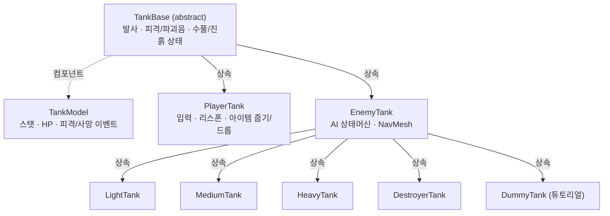

| 공통 기능 | 담당 | 설명 |
| --- | --- | --- |
| 스탯 · HP | `TankModel` | `TankData`(JSON)로 초기화하고 HP 변경 · 피격 · 사망을 이벤트로 알립니다. 장비 스탯은 `ApplyEquipment`로 가감합니다. |
| 발사 | `TankBase.Attack()` | 발사 연출(`PlayAttackEffects`)과 포탄 생성(`SpawnShell`)을 분리해 플레이어와 적이 같은 `Shell`을 씁니다. 멀티플레이어에서는 연출만 각 클라이언트가 재생하고 실제 포탄은 서버만 생성합니다. |
| 피격 경로 | `Shell` → `HitZone` → `TankBase.TakeHit(ref HitData)` | `HitZone`이 맞은 부위(정면 / 측면 / 후면)를 `HitData`에 기록해 넘깁니다. `HitData`는 공격자가 플레이어인지(`IsPlayerAttack`)도 담고 있어, 참조를 보낼 수 없는 RPC에서도 판정에 쓸 수 있습니다. |
| 범위 피해 | `IExplosionDamageable` | 경전차 · 벽 · 벽 조각이 구현해, 직격(`IDamageable`)과 폭발 범위 피해를 분리합니다. |
| 환경 반응 | `TankBase.OnBushEnter` / `OnMudEnter` | 수풀 · 진흙 진입을 카운터로 관리해 경계에서 상태가 꼬이지 않게 합니다. 속도 배율은 `ApplySpeedMultiplier`로 플레이어(`Mover`)와 적(NavMeshAgent)에 각각 반영합니다. |
| 피&#8288;격&#8288;음&#160;·&#160;파&#8288;괴&#8288;음 | `TankBase` | 공통으로 구독해 재생하고, 폭탄 일괄 처치 중에는 큐에 모았다가 한 번만 재생합니다. |

적 상태머신(`EnemyState`)은 한 벌만 두고, 타입마다 달라지는 부분은 `EnemyTank`의 가상 멤버로 열어 두었습니다.<br>
상태머신은 전차 타입을 알 필요가 없습니다.

| 가상 멤버 | 기본 동작 | 재정의 |
| --- | --- | --- |
| `CanAimWhileMoving`, `UsesBodyAim`, `AimAtTarget()` | 포탑으로 조준하고 이동 중에도 조준 | `DestroyerTank` — 포탑이 없어 차체를 돌려 조준하고,<br> 이동 중에는 조준하지 않음 |
| `AgentMove()`, `FleesBackward` | 경로 방향으로<br> 회전한 뒤 전진 | `HeavyTank` — 도주형일 때 후진으로 이탈, `DestroyerTank` — 시야가 트이면 조준 방향으로만 전진 |
| `CanAttackTarget()` | 감지되면 발사 | `DestroyerTank` — 더 좁은 정렬 각도 안에서만 발사 |
| `TakeHit(ref HitData)` | 받은 데미지<br> 그대로 적용 | `HeavyTank` — 부위별 추가 데미지 |

```csharp
// HeavyTank.cs — TakeHit()
public override void TakeHit(ref HitData hitData)
{
    switch (hitData.ZoneType)
    {
        case HitZoneType.None:
        case HitZoneType.Front:
            break;
        case HitZoneType.Side:
            hitData.AddDamage(1);
            break;
        case HitZoneType.Rear:
            hitData.AddDamage(2);
            break;
    }

    base.TakeHit(ref hitData);
}
```

관련 코드: [`TankBase.cs`](https://github.com/gesua/PanzerCity_scripts/blob/main/Character/TankBase.cs) · [`TankModel.cs`](https://github.com/gesua/PanzerCity_scripts/blob/main/Character/TankModel.cs) · [`HitZone.cs`](https://github.com/gesua/PanzerCity_scripts/blob/main/Character/HitZone.cs) · [`IDamageable.cs`](https://github.com/gesua/PanzerCity_scripts/blob/main/Character/IDamageable.cs) · [`EnemyTank.cs`](https://github.com/gesua/PanzerCity_scripts/blob/main/Enemy/EnemyTank.cs) · [`HeavyTank.cs`](https://github.com/gesua/PanzerCity_scripts/blob/main/Enemy/HeavyTank.cs) · [`DestroyerTank.cs`](https://github.com/gesua/PanzerCity_scripts/blob/main/Enemy/DestroyerTank.cs) · [`LightTank.cs`](https://github.com/gesua/PanzerCity_scripts/blob/main/Enemy/LightTank.cs)

### 2. 설정 데이터 관리

밸런스 수치와 스테이지 구성은 코드에 직접 넣지 않고 데이터로 분리했습니다. 용도에 따라 기획 데이터(JSON), 에셋성 데이터(ScriptableObject), 사용자 설정(PlayerPrefs), 진행 데이터(세이브 JSON)로 나눠 관리합니다.

| 종류 | 형식 · 위치 | 내용과 사용처 |
| --- | --- | --- |
| 밸런스 · 스테이지 | JSON 테이블 (`Resources/Data`) | `Tank_Status`(전차 스탯), `Stage_EnemySpawn`(스테이지별 스폰 순서), `Stage_Status`(스폰 간격 · 동시 등장 수), `Item_Master`(아이템 기본 정보), `Item_DropGroup`(가중치 드랍 테이블). `DataManager`가 `JsonUtility`로 읽어 ID 기반 Dictionary로 보관합니다. |
| 아이템 에셋 | ScriptableObject (`ItemConfig`) | 아이콘, 차지하는 칸, 장비 스탯 보너스, 지속 시간, 로컬라이징 키. `Resources.LoadAll`로 읽어 아이템 ID로 조회합니다. |
| 다국어 텍스트 | Unity Localization 테이블 | 아이템 이름 · 설명, 상점 대사, 튜토리얼 문구를 키로 조회합니다(한국어 / 영어). |
| 대사 | ScriptableObject (`DialogueConfig`) | 대사 키와 상점 주인 표정 ID를 연결합니다. |
| 사용자 설정 | `PlayerPrefs` (`OptionData`) | 언어, 음량(마스터 / BGM / SFX), 해상도, 전체화면, 품질, 마우스 감도, 밝기. `OptionManager`가 오디오 믹서 · 화면 · 품질 · 로컬라이제이션에 적용합니다. |
| 진행 데이터 | 슬롯별 JSON | [8. 세이브와 로드](#8-세이브와-로드) 참고 |

- **파생 값은 데이터에서 계산**: 마지막 스테이지는 스폰 데이터의 최대 `StageID`로 구하고(`DataManager.LastStageID`), 스테이지 ID와 씬 이름은 규칙(`7101` → `Stage01`)으로 변환합니다. 스테이지 수가 바뀌어도 마지막 스테이지 판정 코드는 고칠 필요가 없습니다.
- **적 프리팹도 데이터로 결정**: 스폰 테이블의 `TankID`로 `TankData`를 찾고, 프리팹 경로(`Tank/{TankID}{TankType}`)도 이 데이터에서 조립합니다.
- **가중치 랜덤**: 드랍 테이블은 `SpawnWeight` 가중치로 뽑습니다. 적 처치 드랍(`ItemDropper`)과 상점의 장비 한 칸(`ShopUI`)이 같은 방식을 씁니다.
- **JSON → 에셋 자동화**: `Item_Master.json`을 `ItemConfig` ScriptableObject로 바꾸는 작업은 에디터 툴([9. 에디터 툴](#9-에디터-툴))로 자동화했습니다.

관련 코드: [`DataManager.cs`](https://github.com/gesua/PanzerCity_scripts/blob/main/_Manager/DataManager.cs) · [`ItemConfig.cs`](https://github.com/gesua/PanzerCity_scripts/blob/main/Item/ItemConfig.cs) · [`OptionData.cs`](https://github.com/gesua/PanzerCity_scripts/blob/main/_Data/OptionData.cs) · [`OptionManager.cs`](https://github.com/gesua/PanzerCity_scripts/blob/main/_Manager/OptionManager.cs) · [`DialogueConfig.cs`](https://github.com/gesua/PanzerCity_scripts/blob/main/Dialogue/DialogueConfig.cs) · [`ItemConfigImporter.cs`](https://github.com/gesua/PanzerCity_scripts/blob/main/Editor/ItemConfigImporter.cs)

### 3. 적 AI 구조

적의 성격 4종이 어떻게 행동하는지는 [행동 패턴](#행동-패턴)에서 설명했고, 여기서는 구현 구조를 정리합니다.

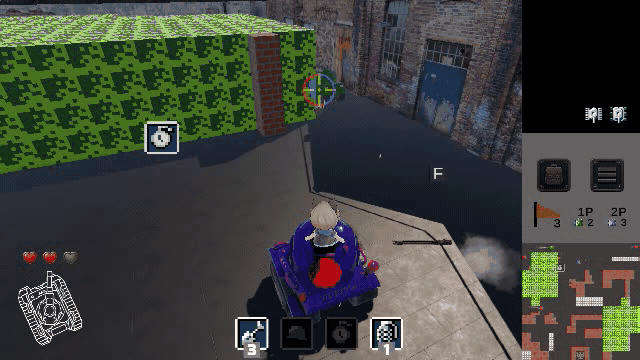

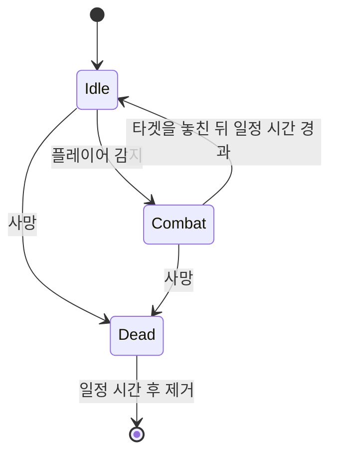

- **상태머신**: `Idle`(배회 · 주기적 발사 · 플레이어 감지) → `Combat`(성격별 교전) → `Dead`(시체 유지 후 제거)를 `EnemyState` 객체로 나누고, `Dead` 상태에서는 다른 상태로 전환되지 않도록 막았습니다.
- **성격 분기**: `Combat` 상태가 성격(고정형 / 무시형 / 공격형 / 도주형)을 분기하고, 전차 타입별 차이는 [가상 멤버](#1-전차-공통-모듈-설계)로 흡수합니다.
- **감지**: 부채꼴 각도 → 시야 차단 Raycast → 수풀 규칙 순으로 검사하고, 시야에서 벗어나도 일정 시간 동안 타겟을 유지합니다.
- **이동과 회전 분리**: NavMeshAgent는 경로 계산에만 쓰고(`updatePosition` / `updateRotation` 비활성), 실제 이동은 `Rigidbody` 속도로, 회전은 직접 제어합니다. 겪은 문제는 [트러블슈팅 1](#1-navmeshagent-위치-어긋남과-경로-흔들림)에 정리했습니다.
- **스폰**: `EnemySpawner`가 스폰 위치를 세트 단위로 셔플해 같은 위치가 연속되지 않게 하고, 위치가 막혀 있으면 다른 위치를 찾거나 재시도하며, 동시에 등장하는 수를 제한합니다.
- **풀링 연동**: 적 전차는 풀링되며, 반환 직전(`OnBeforeReturnToPool`)에 상태머신 참조와 사망 연출을 초기화합니다.

관련 코드: [`EnemyState.cs`](https://github.com/gesua/PanzerCity_scripts/blob/main/Enemy/EnemyState.cs) · [`EnemyTank.cs`](https://github.com/gesua/PanzerCity_scripts/blob/main/Enemy/EnemyTank.cs) · [`EnemySpawner.cs`](https://github.com/gesua/PanzerCity_scripts/blob/main/Enemy/EnemySpawner.cs)

### 4. 카메라 제어와 조준

Cinemachine 위에 3인칭 / 저격 두 개의 가상 카메라를 두고, 두 카메라가 따라가는 `CameraTarget`이 회전 · 감도 · 줌을, `SniperModeController`가 카메라 전환과 모델 표시를, `Turret`이 조준을 나눠 맡습니다.

| 구성 요소 | 역할 |
| --- | --- |
| [`CameraTarget.cs`](https://github.com/gesua/PanzerCity_scripts/blob/main/Camera/CameraTarget.cs) | Cinemachine이 바라보는 타겟입니다. 입력 델타로 yaw · pitch를 누적해(피치 제한, `Slerp` 감쇠) 회전하고, 3인칭은 카메라 거리를, 저격은 FOV를 스크롤 · 핀치로 조절합니다. 저격에서는 FOV 비율만큼 감도를 보정합니다. |
| [`SniperModeController.cs`](https://github.com/gesua/PanzerCity_scripts/blob/main/Camera/SniperModeController.cs) | 3인칭 ↔ 저격 카메라의 Priority를 전환합니다. 저격 중이거나 카메라가 탱크에 가까울 때 탱크 모델과 전차장을 숨기고, 숨김 / 표시 임계값을 분리해 경계에서 깜빡이지 않게 합니다. |
| [`Turret.cs`](https://github.com/gesua/PanzerCity_scripts/blob/main/Player/Turret.cs) | 화면 조준점에서 쏜 레이로 조준 지점을 구해 포탑 좌우 · 포신 상하를 회전하고, 조준한 부위(정면 / 측면 / 후면)에 따라 조준점 색을 바꿉니다. |
| [`CameraBedrockChange.cs`](https://github.com/gesua/PanzerCity_scripts/blob/main/Camera/CameraBedrockChange.cs) | 카메라와 플레이어 사이를 가리는 테두리 벽을 반투명 모델로 교체합니다. |

#### 조준 계산과 조준점 위치

- 화면 조준점에서 나가는 레이는 `Physics.RaycastNonAlloc`으로 구합니다. 결과 순서가 보장되지 않아 정렬하지 않고 조건에 맞는 가장 가까운 충돌만 고르며, 버퍼가 가득 차면 자동으로 늘립니다. 카메라와 포신 사이에 걸린 물체는 무시합니다.
- 3인칭에서는 화면 정중앙을 조준점으로 쓰면 탱크에 가려져서 화면의 0.75 지점으로 올렸고(저격 모드는 0.5), 모드를 바꿀 때는 조준점이 가리키던 월드 지점이 화면의 같은 위치에 오도록 `CameraTarget.AlignWorldPointToScreenPoint`로 카메라를 보정합니다.
- 포탑 회전은 `NetworkTransform`이 로컬 공간으로 동기화하므로 월드 회전이 아니라 `localRotation`을 직접 갱신합니다.
- 관전 대상을 바꿀 때는 `CameraTarget.SetTarget`으로 타겟을 교체하고, 대상이 실제로 바뀔 때만 고정 부감 각도로 리셋(`ResetToSpectateAngle`)합니다. 리스폰과 관전 중에는 댐핑을 꺼(`DisableDamping`) 카메라가 즉시 따라가게 합니다.

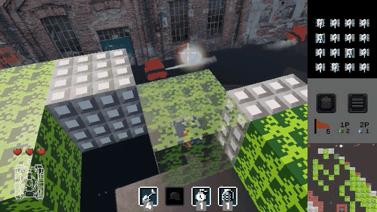

#### 적 실루엣 하이라이트 — 아웃라인에서 실루엣으로 전환

조준한 적에게 아웃라인을 표시하려고 셰이더와 셰이더 그래프로 여러 방식을 시도했지만 난이도가 높아, 실루엣 방식으로 방향을 바꿨습니다. 처음에는 실루엣을 적 탱크 위에 겹쳐 그리고 CustomRenderQueue로 그려지는 순서만 늦추는 방식을 썼는데, 다른 탱크에 가려질 때는 실루엣이 표시되지 않는 문제가 있었습니다. 이를 렌더러의 스텐실(Stencil) 값을 이용하는 방식으로 다시 구현했습니다 — 조준된 탱크 모델의 레이어를 바꾸고, 그 레이어가 다른 오브젝트에 가려질 때만 실루엣 레이어에 색이 칠해지도록 처리해 해결했습니다.

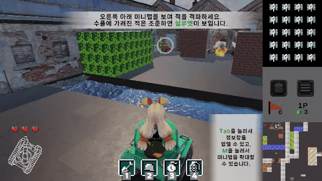

조준한 적은 `Turret`이 판정하고, `EnemyTank.ToggleEnemySilhouette`가 모델 레이어와 실루엣 모델을 전환합니다.

### 5. 멀티플레이어 확장

#### 싱글플레이어를 침범하지 않는 확장

싱글플레이어의 동작을 바꾸지 않는 것을 원칙으로 삼았습니다. 멀티플레이어 로직은 `EnemyNetworkOwner`, `PlayerNetworkOwner`, `ShellNetworkOwner` 같은 브릿지 컴포넌트를 기존 오브젝트에 컴포지션으로 붙여 모으고, 기존 클래스에는 싱글 / 멀티를 가르는 분기만 최소한으로 추가했습니다.

```csharp
// PlayerTank.cs — Attack()
if (_networkOwner != null)
{
    if (_networkOwner.IsServer) _networkOwner.HandleAttackOnServer(_firePoint.position, _firePoint.rotation); // 호스트 자신이면 바로 처리
    else _networkOwner.RequestAttackServerRpc(_firePoint.position, _firePoint.rotation); // 비호스트면 서버에 요청
}
else
{
    SpawnShell(); // 싱글플레이
}
```

`PlayerTank`, `EnemyTank`, `Shell`, `ItemPickup`처럼 개체 단위 클래스는 `_networkOwner`의 null 여부로, `GameScene`, `StageScene`, `ShopUI`, `EnemySpawner`처럼 씬 · 스테이지 단위 클래스는 `NetworkManager.Singleton.IsListening`으로 싱글 / 멀티를 판별합니다. 분기는 멀티플레이어일 때만 네트워크 경로로 들어가도록 작성해 싱글플레이어 경로의 동작은 그대로 두었고, 구현 마지막 단계([로드맵](#구현-로드맵) 8단계)에서 싱글 회귀 테스트로 확인했습니다. 개체 단위 RPC는 각 Owner 컴포넌트가 직접 가지고 있고, 스테이지 진행 · 전원 사망 · 아이템 효과 · 채팅처럼 씬 단위의 전역 이벤트는 `NetworkGameManager`가 중계합니다.

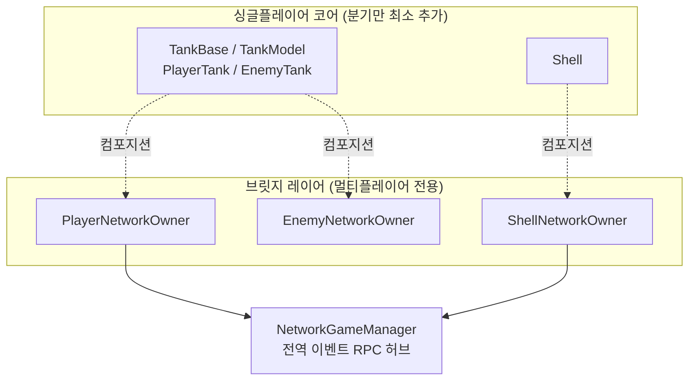

#### 서버 권위 판정 + 클라이언트 로컬 재현

포탄(Shell)과 적 탱크(EnemyTank)의 충돌 판정 및 이동 갱신은 각각 `ShellNetworkOwner`, `EnemyNetworkOwner`가 호출하는 `SetNetworkControl(IsServer)`로 가드되어 있어, 피격 판정(무엇이 누구를 맞혔는지)은 항상 서버에서만 실행됩니다. 판정 결과는 `NotifyDirectHitDamage`, `NotifyExplosionDamage`로 모든 클라이언트에 전파되고, 각 클라이언트는 이 이벤트를 받아 로컬에서 동일한 결과를 재현합니다.

이 HP 값을 다른 클라이언트 화면에 보여주는 방식은 대상마다 다릅니다. 적 탱크는 판정 이벤트 전파만으로 충분해서 별도 동기화 변수를 두지 않았지만, 플레이어 탱크(`PlayerNetworkOwner`)는 `NetworkVariable<int> _hp`(Owner-write, Everyone-read)를 따로 둡니다. 소유 클라이언트가 서버 판정 결과를 반영해 로컬에서 확정한 HP 값을 그대로 이 변수에 실어 보내면, 나머지 클라이언트는 값 변경 이벤트만 구독해서 화면에 반영합니다. 즉 '누가 맞았는가'는 서버가 판정하고, 플레이어의 HP · 목숨 · 무적 같은 수치는 소유 클라이언트가 확정해 동기화하는 구조입니다. PvE 협동 위주라 치팅 방지보다 개발 비용 절감을 우선한 선택입니다([설정 근거](#설정-근거) 참고).

```csharp
// PlayerNetworkOwner.cs
NetworkVariable<int> _hp = new NetworkVariable<int>(0, NetworkVariableReadPermission.Everyone, NetworkVariableWritePermission.Owner);

void HandleLocalHpChanged(int current, int max) => _hp.Value = current;

void HandleHpValueChanged(int previousValue, int currentValue)
{
    if (IsOwner) return; // 오너 자신은 TakeDamage에서 이미 직접 반영
    _playerTank.ApplySyncedHp(currentValue);
}
```

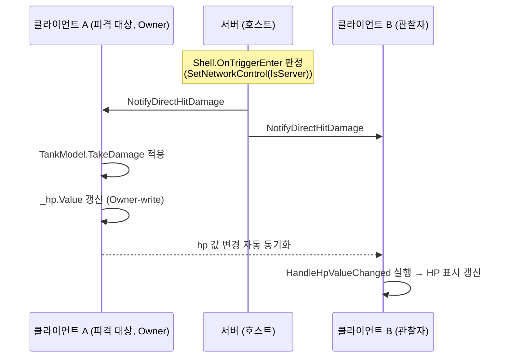

이 구조에 도달하기까지의 과정은 바로 아래 '판정 주체 실험'에 정리했습니다.

#### 판정 주체 실험

처음에는 포탄의 이동과 충돌 판정을 모두 서버 권위로 구현했습니다. 반응성을 개선하고 싶어서 피격/파괴 판정만 클라이언트 권위로 바꿔봤는데, 포탄 생성은 서버가 하고 판정은 클라이언트가 하다 보니 포탄 위치 동기화 오차로 실제로 맞지 않은 플레이어가 피격 처리되거나 벽 뒤에서 포탄이 터지는 버그가 발생했습니다. 판정 일관성이 반응성보다 중요하다고 판단해 피격 판정을 다시 서버 권위로 되돌렸고, 이게 지금의 아키텍처입니다.

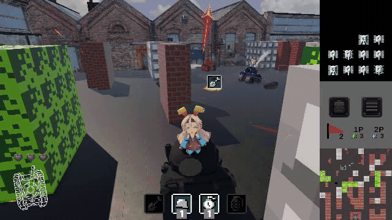

#### 그 외 구현 포인트

| 영역 | 구현 |
| --- | --- |
| 연결 | Unity Authentication(익명 로그인) 후 Lobby를 만들고 Relay 할당 · 참가로 연결합니다(조인 코드는 Lobby 데이터로 전달). 호스트는 하트비트로 로비를 유지하고, 참가자는 폴링으로 방 상태 갱신과 강퇴를 감지합니다. 로비 비밀번호의 최소 길이 제한은 내부에서 접미사를 붙여 우회합니다. (`LobbyManager`) |
| 동시 시작 | 씬 로드 완료가 아니라 각 클라이언트의 게임플레이 초기화 완료(`GameScene.Initialize()`)를 서버로 보고받고, 전원이 모이면 로딩창 종료와 적 스폰을 같은 시점에 시작합니다. 중간에 누가 나가도 남은 인원 기준으로 다시 판정합니다. (`NetworkGameManager`) |
| 동기화 방식 | 위치는 `NetworkTransform`, 플레이어 수치(HP · 목숨 · 무적 · 닉네임 · 룸 자리)는 Owner-write `NetworkVariable`, 판정 결과와 전역 이벤트는 RPC로 나눠 전달합니다. (`PlayerNetworkOwner`) |
| 적 · 포탄 · 드랍 아이템 | 서버만 AI와 판정을 수행하고 클라이언트는 위치와 연출만 재현합니다. 생성과 반환은 풀링과 연동됩니다([7. 오브젝트 풀링](#7-오브젝트-풀링)). 드랍 아이템 줍기는 클라이언트가 요청하고 서버가 승인해, 동시에 줍는 경합을 막습니다. (`EnemyNetworkOwner`, `ShellNetworkOwner`, `DroppedItemNetworkOwner`) |
| 패배 · 관전 | 목숨 0에서 한 번 더 죽으면 탈락 상태(`EliminatedLife`)로 표시하고, 살아있는 아군이 있으면 관전 카메라로 전환합니다. 전원 탈락은 호스트만 판정해 전파하며, 클리어 후 상점에서 탈락자는 마지막 목숨으로 되살아납니다. (`PlayerNetworkOwner`, `SpectatorController`) |
| 상점 | 다음 스테이지 준비 인원(`n/m`)을 집계해 전원이 준비하면 함께 이동합니다. 다른 플레이어의 커서는 해상도 차이를 감안해 화면 비율(0~1) 좌표로 동기화해 표시합니다. (`ShopUI`, `PlayerCursorSync`) |
| 채팅 | 룸 채팅은 서버(`RoomChatRelay`)가 닉네임 · 색상 · 중복 구분까지 붙인 한 줄을 전원에게 보내고, 인게임 채팅(`ChatUI`)은 발신자 ID와 메시지를 받아 각 클라이언트가 닉네임과 색상을 조회합니다. 둘 다 한글 조합(IME) 문제 때문에 Enter를 직접 판정하지 않고 TMP `onSubmit`을 씁니다. |

설정 근거와 구현 로드맵은 [멀티플레이어 설계 과정](#멀티플레이어-설계-과정)에 정리했습니다.

관련 코드: [`NetworkGameManager.cs`](https://github.com/gesua/PanzerCity_scripts/blob/main/Multiplayer/Network/NetworkGameManager.cs) · [`PlayerNetworkOwner.cs`](https://github.com/gesua/PanzerCity_scripts/blob/main/Multiplayer/Network/PlayerNetworkOwner.cs) · [`EnemyNetworkOwner.cs`](https://github.com/gesua/PanzerCity_scripts/blob/main/Multiplayer/Network/EnemyNetworkOwner.cs) · [`ShellNetworkOwner.cs`](https://github.com/gesua/PanzerCity_scripts/blob/main/Multiplayer/Network/ShellNetworkOwner.cs) · [`DroppedItemNetworkOwner.cs`](https://github.com/gesua/PanzerCity_scripts/blob/main/Multiplayer/Network/DroppedItemNetworkOwner.cs) · [`LobbyManager.cs`](https://github.com/gesua/PanzerCity_scripts/blob/main/Multiplayer/Lobby/LobbyManager.cs) · [`SpectatorController.cs`](https://github.com/gesua/PanzerCity_scripts/blob/main/Multiplayer/Network/SpectatorController.cs) · [`PlayerCursorSync.cs`](https://github.com/gesua/PanzerCity_scripts/blob/main/Multiplayer/Network/PlayerCursorSync.cs) · [`RoomChatRelay.cs`](https://github.com/gesua/PanzerCity_scripts/blob/main/Multiplayer/Lobby/RoomChatRelay.cs)

### 6. 그리드 인벤토리와 장착 롤백

인벤토리는 Model(`InventoryModel`) / View(`InventoryView`) / Presenter(`InventoryPresenter`)로 역할을 분리했습니다. `InventoryModel`은 그리드 상태와 배치 가능 여부 판정만 담당하고, `InventoryView`는 셀·아이템의 시각적 표현만 담당하며, `InventoryPresenter`가 드래그·클릭 입력을 받아 둘을 연결합니다.

아이템마다 차지하는 칸 모양이 달라서, 배치 가능 여부는 아이템이 차지할 모든 셀이 그리드 범위 안에 있고 비어 있는지를 함께 검사해 판단합니다. 드래그 중에는 호버한 위치 기준으로 이 판정 결과를 셀 색상(초록/빨강)에 실시간으로 반영합니다.

장비 슬롯은 그리드와 분리된 별도 슬롯이지만, 상점에서 그리드의 장비 아이템을 클릭하면 장착과 동시에 그리드에서 빠지고 기존 장착 아이템은 그리드 빈 자리로 자동 반환됩니다. 이때 반환할 자리가 없으면 장착 자체를 되돌려, 스왑 과정에서 아이템이 유실되는 상황을 방지합니다. 같은 클릭 핸들러가 상점/필드 여부(`_isShop`)에 따라 장착과 소모로 갈리는 것도 Presenter가 조율합니다. 클릭뿐 아니라 인벤토리와 장비 슬롯 사이의 드래그 앤 드롭으로도 장착 · 해제할 수 있습니다(`EquipmentSlotUI`, `GridCell`).

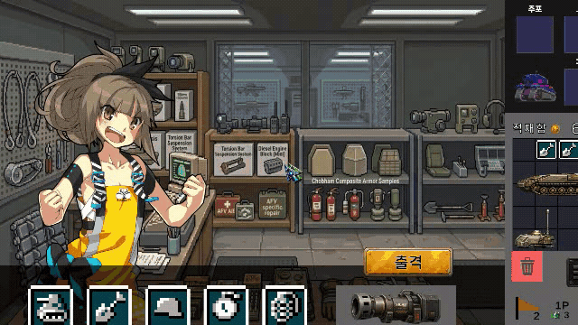

```csharp
// InventoryPresenter.cs — EquipFromInventory()
ItemModel prevItem = _equipmentManager.Equip(item);
// ...
if (prevItem != null)
{
    bool added = AddItem(prevItem); // 기존 장착 아이템을 인벤토리로 반환 시도
    if (added == false)
    {
        // 반환할 자리가 없으면 장착 자체를 되돌림 (아이템 유실 방지)
        _equipmentManager.Equip(prevItem);
        AddItem(item);
    }
}
```

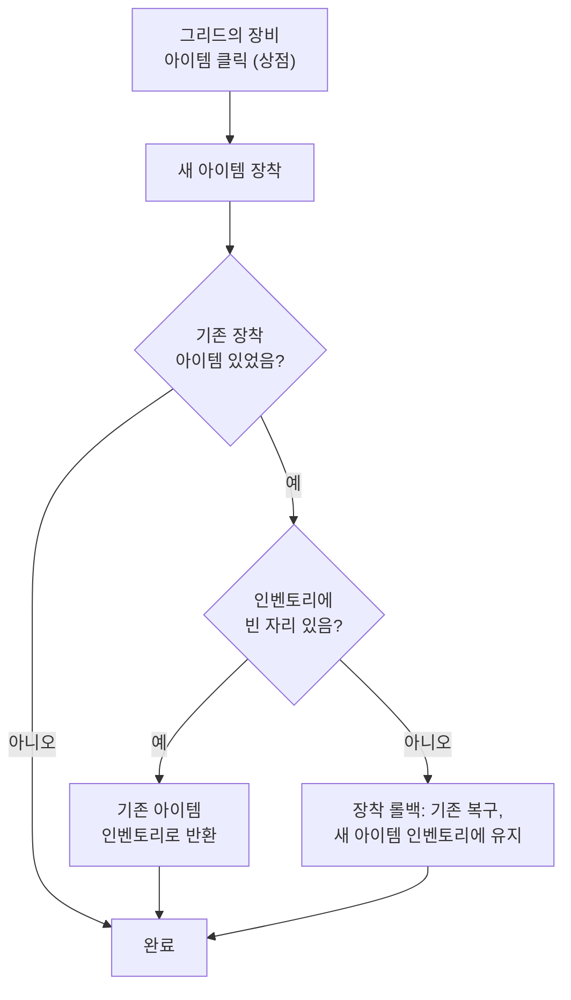

### 7. 오브젝트 풀링

포탄, 드랍 아이템, 적 전차, 이펙트, 효과음, 인벤토리 아이템 뷰처럼 반복해서 생성되는 객체는 풀링합니다.

| 구성 요소 | 역할 |
| --- | --- |
| [`PoolManager.cs`](https://github.com/gesua/PanzerCity_scripts/blob/main/_Manager/PoolManager.cs) | 프리팹 경로를 키로 `Pool`을 지연 생성 · 캐싱하고, 스테이지 전환 · 재시작 때 남은 포탄 · 아이템을 `ReturnAllPools()`로 일괄 회수합니다. 인벤토리 UI 풀처럼 유지되어야 하는 풀은 회수 대상에서 제외합니다(`includeInReturnAll`). |
| [`Pool.cs`](https://github.com/gesua/PanzerCity_scripts/blob/main/_Util/Pool.cs) | 사용 가능한 객체 스택과 사용 중인 객체 집합을 함께 관리해, 같은 객체의 중복 반환을 걸러냅니다. |
| [`Poolable.cs`](https://github.com/gesua/PanzerCity_scripts/blob/main/_Util/Poolable.cs) | 풀에서 나온 객체에 붙어 스스로 반환(`ReturnToPool`)합니다. `DestroyOrReturnToPool()` 확장 메서드로 풀링 여부와 상관없이 같은 방식으로 정리할 수 있습니다. |
| `IPoolReturnHandler` | 반환 직전 정리 훅(`OnBeforeReturnToPool`)입니다. 포탄은 레이어 · 속도 초기화, 적 전차는 상태머신 참조와 사망 연출 초기화, 아이템 뷰는 이벤트 해제를 합니다. |
| [`NetworkPoolPrefabHandler.cs`](https://github.com/gesua/PanzerCity_scripts/blob/main/Multiplayer/Network/NetworkPoolPrefabHandler.cs) | 멀티플레이어에서 클라이언트 쪽 스폰 · 디스폰을 Netcode 기본 동작(Instantiate / Destroy) 대신 풀로 위임합니다. |

`NetworkObject`는 스폰되기 전에는 재부모화할 수 없고 `Destroy`도 금지되어 있어, 풀은 `NetworkObject`를 부모에 붙이지 않고 `DontDestroyOnLoad`로 보호합니다. 서버는 반환할 때 `Despawn(false)`로 스폰 상태만 해제하고 `GameObject`는 그대로 재사용합니다. 중복 반환으로 겪은 문제는 [트러블슈팅 2](#2-포탄-이중-반환으로-인한-pool-네트워크-id-꼬임)에 정리했습니다.

### 8. 세이브와 로드

- **슬롯**: 슬롯 6개를 슬롯별 JSON 파일(`persistentDataPath`)로 저장합니다. 시작할 때 전부 읽어 캐시에 두고 슬롯 UI와 이어하기 판단에 사용해 파일 입출력을 최소화합니다.
- **저장 내용**: 스테이지, 골드 · 목숨, 인벤토리(아이템 ID · 위치 · 회전), 장착 장비 3슬롯, 누적 통계(획득 골드 · 아이템 사용 · 격파 · 사망 · 플레이 시간).
- **저장 시점**: 스테이지가 시작될 때 자동 저장합니다. 튜토리얼은 세이브 시스템을 쓰지 않는 모드로 진입합니다.
- **이어하기**: 저장된 데이터를 `PlayerData`, `EquipmentManager`, 인벤토리, `GameStatistics`가 각자 `LoadFromSaveData`로 복원합니다.
- **재도전은 세이브와 분리**: 스테이지 재도전은 디스크가 아니라 스테이지 진입 시점의 메모리 스냅샷(`SaveSnapshot` / `RestoreSnapshot`)으로 목숨 · 골드 · 인벤토리를 복구합니다. 통계(플레이 시간 · 사망 횟수 등)는 재도전해도 계속 누적됩니다.
- **슬롯 UI**: 새 슬롯 생성 · 이름 변경 · 삭제를 지원하고, 슬롯이 하나씩 팝업되는 연출로 표시합니다.

관련 코드: [`SaveManager.cs`](https://github.com/gesua/PanzerCity_scripts/blob/main/Save/SaveManager.cs) · [`SaveData.cs`](https://github.com/gesua/PanzerCity_scripts/blob/main/Save/SaveData.cs) · [`SaveSlotUI.cs`](https://github.com/gesua/PanzerCity_scripts/blob/main/Save/SaveSlotUI.cs) · [`SaveSlotPanel.cs`](https://github.com/gesua/PanzerCity_scripts/blob/main/Save/SaveSlotPanel.cs)

### 9. 에디터 툴

반복 작업은 에디터 툴로 자동화했습니다. 수풀 · 물 툴은 실행 취소(`Undo`)를 지원합니다.

| 툴 | 메뉴 | 자동화하는 작업 |
| --- | --- | --- |
| [`BushOptimizerWindow.cs`](https://github.com/gesua/PanzerCity_scripts/blob/main/Editor/BushOptimizerWindow.cs) | `Tools/풀숲 겹침 최적화` | 맞닿은 수풀 블록의 안쪽 면 판넬을 끄고 `BushGroup`의 Renderer 목록을 다시 연결 |
| [`WaterOptimizerWindow.cs`](https://github.com/gesua/PanzerCity_scripts/blob/main/Editor/WaterOptimizerWindow.cs) | `Tools/물 타일 겹침 최적화` | 맞닿은 물 타일의 안쪽 면 판넬을 끔 |
| [`ItemConfigImporter.cs`](https://github.com/gesua/PanzerCity_scripts/blob/main/Editor/ItemConfigImporter.cs) | `Tools/Import Item Config` | `Item_Master.json`을 읽어 `ItemConfig` ScriptableObject를 생성 · 갱신 |
| [`FontAssetReplacer.cs`](https://github.com/gesua/PanzerCity_scripts/blob/main/Editor/FontAssetReplacer.cs) | `Tools/Font/Replace RussoOne Font` | 프리팹과 씬의 TMP 폰트 에셋을 일괄 교체(확인 창 후 실행, 결과는 로그로 출력) |
| `AudioManager` 컨텍스트 메뉴 | 컴포넌트 우클릭 | enum에 추가된 BGM / SFX 종류의 빈 슬롯을 자동으로 만듦 |

#### 수풀 겹침 최적화 — 동작 방식

수풀은 `BushBlock` 하나가 상 · 하 · 좌 · 우 4면 판넬과 천장으로 이루어져 있고, 블록을 이어 붙여 큰 수풀을 만듭니다. 블록끼리 맞닿은 안쪽 면은 보이지 않는데도 판넬이 그대로 남아 렌더링되고, 플레이어가 들어갈 때 반투명 머티리얼로 교체하는 `BushGroup`의 Renderer 목록에도 포함됩니다. 이 안쪽 면을 맵마다 수동으로 끄고 목록을 다시 연결하는 작업을 자동화했습니다.

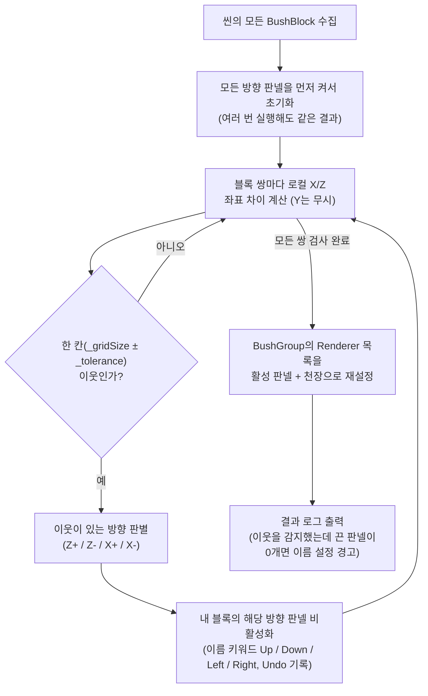

```csharp
// BushOptimizerWindow.cs — 인접 블록 판정 (X/Z 좌표만 사용, Y는 무시)
// Y축은 무시하고 X/Z 좌표만 사용하여 그리드 인접 여부를 확인
// 풀숲의 높이가 조금 달라도 같은 그리드 위치로 판단
float deltaX = Mathf.Abs(diff.x);
float deltaZ = Mathf.Abs(diff.z);

bool isHorizontalNeighbor =
    Mathf.Abs(deltaX - _gridSize) <= _tolerance &&
    deltaZ <= _tolerance;

bool isVerticalNeighbor =
    Mathf.Abs(deltaZ - _gridSize) <= _tolerance &&
    deltaX <= _tolerance;
```

- 방향 판넬을 찾는 이름 키워드(Up / Down / Left / Right), 블록 간격(`_gridSize`), 좌표 오차(`_tolerance`)는 창에서 설정합니다.
- 이웃을 감지했는데 끈 판넬이 하나도 없으면 판넬 이름이 실제 오브젝트와 맞지 않는 것으로 보고 경고 로그를 남깁니다.
- `모든 판넬 다시 켜기` 버튼으로 초기 상태로 되돌릴 수 있습니다.

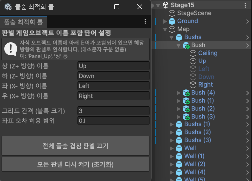

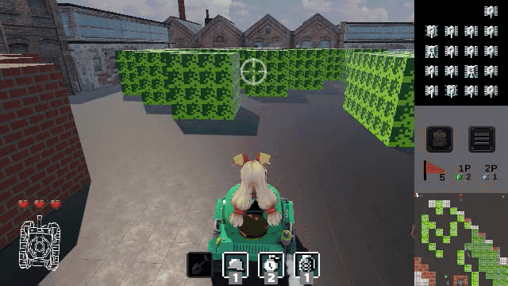

#### 그 외 툴

- **물 타일**: `WaterVolumeTransforms` 아래 직계 자식 `Marker`를 타일로 보고 같은 방식으로 Up / Down / Left / Right 판넬을 끕니다(바닥과 미니맵 아이콘은 건드리지 않습니다).
- **아이템 임포터**: `Item_Master.json`의 ID와 이름으로 에셋 경로(`Assets/Resources/Items/{ID}{이름}.asset`)를 만들어 없으면 생성하고, private `[SerializeField]` 필드는 `SerializedObject`로 접근해 채웁니다. 차지하는 칸이 비어 있으면 한 칸(`(0,0)`)을 기본으로 넣습니다.

### 10. 디버그 기능

개발과 테스트 중 반복 작업을 줄이고 문제를 눈으로 확인하기 위한 도구들입니다. 에디터에서만 필요한 것은 `#if UNITY_EDITOR`로 빌드에서 제외했습니다.

| 기능 | 구현 | 설명 |
| --- | --- | --- |
| 치트 토글 | `GameScene` | Inspector 체크박스로 아이템 지급(ID 지정) · 골드 지급 · 스테이지 즉시 클리어를 실행합니다. 체크하면 `Update`에서 한 번 실행하고 해제되며, 에디터에서만 동작합니다. |
| 무적 · HP 무한 | `TankModel` | Inspector 토글(`_noDamage`, `_infiniteHP`)로 피격 · 사망을 무시해 스테이지 흐름을 빠르게 확인합니다. |
| Gizmos 시각화 | `EnemyTank`, `EnemySpawner`, `StageScene`, `PlayerTank` | 적의 이동 차단 Raycast(막히면 빨강)와 NavMesh 경로, 스폰 체크 반경, 플레이어 스폰 지점, 리스폰 밀어내기 반경을 씬 뷰에 표시합니다. |
| 에디터 전용 테스트 분기 | `EnemyTank`, `DataManager` | 적 성격 고정, 마지막 스테이지 변경 같은 테스트 코드를 `#if UNITY_EDITOR` 안에 주석으로 두고 필요할 때만 켭니다. |
| FPS 카운터 | `FPSCounter` | 프레임 시간을 평균내어 FPS를 표시합니다. 씬을 다시 불러올 때 복제본이 쌓이지 않도록 하나만 유지하고, 중복을 제거하면 경고 로그를 남깁니다. |
| 모바일 테스트 모드 | `MobileTestMode` | 에디터에서 마우스를 가상 터치로 바꾸고 커서 잠금을 풀어, 조이스틱 · 룩존 · 버튼을 마우스로 눌러 볼 수 있게 합니다. 빌드에서는 아무 동작도 하지 않습니다. |
| 멀티플레이어 테스트 | Unity Multiplayer Play Mode | 에디터에서 가상 플레이어를 함께 실행해 멀티플레이어 흐름을 테스트합니다. |
| 중복 실행 방지 | `SingleInstanceGuard` | 빌드에서만 `Mutex`로 같은 PC의 중복 실행을 막습니다. 씬이 로드되기 전에 독립적으로 실행(`RuntimeInitializeOnLoadMethod`)되어 매니저 초기화 순서의 영향을 받지 않습니다. |
| 방어적 경고 로그 | 전반 | 연결 누락 · 클립 누락 · 데이터 누락처럼 놓치기 쉬운 참조는 `Debug.LogWarning`으로 원인을 바로 알 수 있게 남깁니다. |

관련 코드: [`GameScene.cs`](https://github.com/gesua/PanzerCity_scripts/blob/main/Scene/GameScene.cs) · [`TankModel.cs`](https://github.com/gesua/PanzerCity_scripts/blob/main/Character/TankModel.cs) · [`FPSCounter.cs`](https://github.com/gesua/PanzerCity_scripts/blob/main/UI/FPSCounter.cs) · [`MobileTestMode.cs`](https://github.com/gesua/PanzerCity_scripts/blob/main/Player/Mobile/MobileTestMode.cs) · [`SingleInstanceGuard.cs`](https://github.com/gesua/PanzerCity_scripts/blob/main/_Manager/SingleInstanceGuard.cs)

### 11. 모바일 환경 대응

PC 조작(키보드 · 마우스)과 모바일 터치 조작이 같은 게임 로직을 공유하도록, 입력을 `InputSystemHandler` 한 곳으로 모았습니다. 모바일 입력은 터치 UI 컴포넌트가 이 핸들러에 값을 전달하는 방식이라, `GameScene`은 입력이 키보드에서 왔는지 터치에서 왔는지 구분하지 않습니다. 일시정지 · 상점처럼 입력을 막는 상태에서는 터치 입력도 함께 차단됩니다.

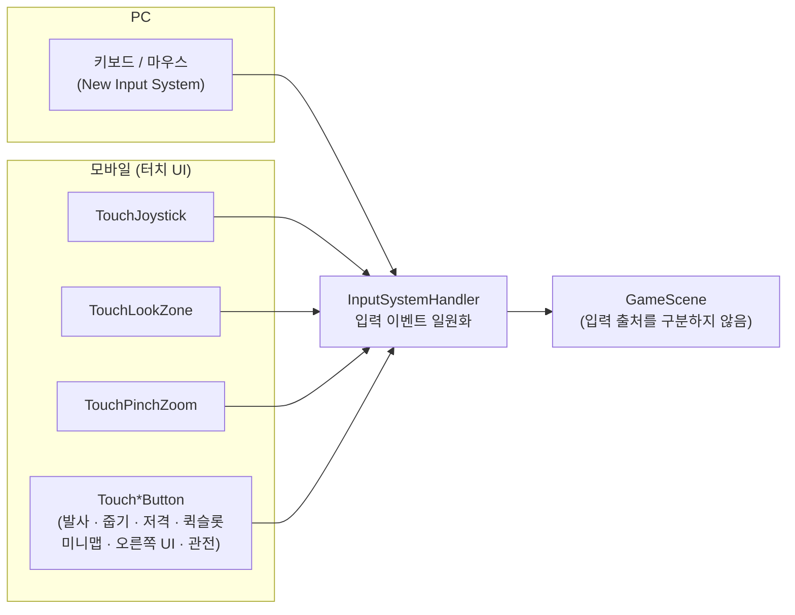

| 컴포넌트 | 역할 |
| --- | --- |
| [`MobileUIController.cs`](https://github.com/gesua/PanzerCity_scripts/blob/main/Player/Mobile/MobileUIController.cs) | `Application.isMobilePlatform`(에디터에서는 테스트 모드 활성 여부)으로 모바일 전용 UI를 켜고, 플랫폼별로 표시가 달라지는 스크립트가 참조할 수 있도록 `IsMobile`을 공개합니다. |
| [`TouchJoystick.cs`](https://github.com/gesua/PanzerCity_scripts/blob/main/Player/Mobile/TouchJoystick.cs) | 고정 위치 조이스틱입니다. 핸들 위치를 정규화한 방향 값을 매 프레임 전달하고, 수평축에서 일정 각도 이내의 입력은 세로 입력을 제거해 좌우 회전이 쉽도록 보정합니다. |
| [`TouchLookZone.cs`](https://github.com/gesua/PanzerCity_scripts/blob/main/Player/Mobile/TouchLookZone.cs) | 드래그로 카메라를 회전합니다. 터치 픽셀 델타는 마우스 델타보다 커서 감도를 줄여 전달하고, 손가락이 2개 이상이면 핀치 줌으로 보고 회전하지 않습니다. |
| [`TouchPinchZoom.cs`](https://github.com/gesua/PanzerCity_scripts/blob/main/Player/Mobile/TouchPinchZoom.cs) | 두 손가락 사이 거리의 변화를 줌 입력(스크롤 값)으로 변환합니다. |
| `Touch*Button` 7종 | 발사 · 줍기 · 저격 · 퀵슬롯 · 미니맵 · 오른쪽 UI · 관전 대상 전환 버튼입니다. |
| [`PickupHintIcon.cs`](https://github.com/gesua/PanzerCity_scripts/blob/main/Item/PickupHintIcon.cs) | 줍기 힌트를 PC는 키 아이콘, 모바일은 버튼 아이콘으로 바꿔 보여줍니다. |
| [`MobileTestMode.cs`](https://github.com/gesua/PanzerCity_scripts/blob/main/Player/Mobile/MobileTestMode.cs) | 에디터 전용으로, 마우스를 가상 터치로 바꿔 에디터에서 모바일 UI를 테스트합니다. |

구현하며 신경 쓴 부분은 다음과 같습니다.

- **마우스 델타 흉내**: 마우스 델타는 손이 멈추면 0이 되지만 uGUI의 `OnDrag`는 움직임이 없는 프레임에는 호출되지 않습니다. 그래서 드래그 중 값을 누적했다가 매 프레임 소비한 뒤 0으로 초기화해, 입력 핸들러가 마우스와 같은 방식으로 값을 받게 했습니다(`TouchLookZone`, `TouchPinchZoom`).

```csharp
// TouchLookZone.cs — Update()  (누적한 드래그 값을 매 프레임 소비하고 0으로 초기화)
void Update()
{
    _inputSystemHandler.SetMobileLookInput(_pendingDelta);
    _pendingDelta = Vector2.zero;
}
```

- **손가락이 남는 문제 방지**: 손가락을 누른 채 UI가 꺼지면 `OnPointerUp`이 오지 않아 입력이 영구히 막힐 수 있어, `OnDisable`에서 손가락 정보와 누적 값을 정리합니다.
- **핀치 줌 안정화**: 손가락이 정확히 2개일 때만 기준 거리를 다시 잡아, 세 번째 손가락이 닿았다 떨어져도 줌이 튀지 않게 했습니다.
- **화면 비율 대응**: 다양한 화면 비율에 맞추기 위해 Canvas Scaler를 Expand로 설정하고, 타이틀 배경은 Aspect Ratio Fitter(Envelope Parent)로 비율을 유지한 채 화면을 채웁니다.
- **플랫폼별 문구**: 튜토리얼 문구는 모바일이면 기본 키 뒤에 `_MOBILE`이 붙은 전용 키가 있을 때 그 문구를 쓰고, 없으면 PC 문구를 씁니다. 탈락 시 관전 안내 문구도 PC / 모바일 키를 나눠 두었습니다.

## 트러블슈팅

기능을 완성하는 것보다, 왜 그렇게 만들었고 어떤 시행착오를 거쳤는지가 더 중요하다고 생각합니다. 실제로 겪었던 문제와 해결 과정 중 일부를 정리했습니다. 설계 과정에서 내린 결정은 [핵심 구현 사항](#핵심-구현-사항)에 두었습니다.

### 1. NavMeshAgent 위치 어긋남과 경로 흔들림

- **문제**: NavMesh 에이전트는 경로 계산에만 쓰고 이동은 `Rigidbody`, 회전은 별도 로직으로 직접 제어하고 싶어서 `updatePosition`, `updateRotation`을 꺼두었습니다. 그런데도 에이전트가 미세하게 위치를 갱신했고, 목적지를 다시 잡을 때 경로가 순간적으로 튀는(jitter) 현상도 있었습니다.
- **시도**: `_agent.speed = 0`으로 강제 고정하면 위치 갱신은 멈췄지만, 오히려 `speed` 값을 다시 채워 주어야 경로가 튀지 않았습니다.
- **해결**: 현재는 ① `speed`, `angularSpeed`를 전차 스탯으로 채워 두고, ② 에이전트 위치를 매 프레임 실제 전차 위치로 동기화하며(`nextPosition`), ③ 목적지가 임계값 이상 바뀔 때만 `SetDestination`을 다시 호출해 리패스를 줄이고, ④ 경로를 계산 중이거나 코너가 갖춰지지 않은 프레임은 이동을 건너뜁니다.

```csharp
// EnemyTank.cs — Awake()
// _agent 설정
// 이동 막아놔도 speed, angularSpeed가 들어있어야 경로가 튀지 않음
_agent.enabled = false;
_agent.speed = _model.ForwardSpeed;
_agent.angularSpeed = _model.RotSpeed;
_agent.stoppingDistance = _stoppingDistance;

// 전진/회전 못하게 막아놓기
_agent.updatePosition = false; // 전진X
_agent.updateRotation = false; // 회전X
```

```csharp
// EnemyTank.cs — AgentMove()
// updatePosition이 꺼져 있어 Agent가 스스로 위치를 추적하지 못하므로 매 프레임 실제 위치로 동기화
// (여기서 매 프레임 갱신하지 않으면 목적지 재탐색 시점에 위치가 한꺼번에 튀면서 steeringTarget이 순간적으로 어긋남)
_agent.nextPosition = transform.position;
```

### 2. 포탄 이중 반환으로 인한 Pool 네트워크 ID 꼬임

- **문제**: 멀티플레이어 진행 중 아이템 드랍이나 적 스폰 시 간헐적으로 에러가 발생했습니다(싱글플레이어에서도 한 번 겪었던 문제입니다).
- **원인**: 포탄이 풀에 두 번 반환되면서 네트워크 ID가 꼬였습니다.
- **해결**: `Pool.Push()`에 사용 중인 객체 집합(`_activeObjects`)으로 이미 반환된 객체를 걸러내는 가드를 추가했습니다. `Shell`에도 한 번에 `OnTriggerEnter`에 여러 번 들어오는 경우를 막는 반환 여부 플래그(`_isReleased`)가 있습니다.

```csharp
// Pool.cs — Push()
// 이미 Pool에 반환되어 있는 오브젝트면 무시(중복 반환 방지)
if (_activeObjects.Contains(go) == false)
{
    //Debug.LogWarning($"{go.name}이 이미 Pool에 반환되어 있음(중복 Push 무시)");
    return;
}
```

### 3. 호스트 send queue full 에러

- **문제**: 호스트에서 간헐적으로 매 프레임 네트워크 `send queue full` 에러가 발생했습니다.
- **원인(추정)**: 적이 두 번 발사되는 버그가 있었고, 장전 시간과 타이머 값이 꼬이면서 에러가 발생한 것으로 추정하고 있습니다.
- **해결**: 상태에 들어가고 나올 때 배회 · 교전(공격) 타이머를 초기화하도록 수정했고, 이후로는 에러가 재현되지 않았습니다.

### 4. 스테이지 전환 중 Receive queue full과 씬 로드 지연

- **문제**: 2 → 3스테이지로 넘어가는 중 호스트에서 `Receive queue full` 에러와 씬 로드 지연이 관찰됐습니다.
- **원인**: 바닥에 남은 드랍 아이템을 정리하면서 `Despawn`을 한 프레임에 몰아서 호출하면 스톨이 생길 수 있었습니다.
- **해결**: 정리를 여러 프레임에 나눠 처리하도록 바꿨습니다(5개 처리마다 한 프레임 대기). 정리가 끝날 때까지 스테이지 클리어 처리가 기다리므로, 정리 도중에 다음 스테이지로 넘어가지 않는 것도 보장됩니다.

```csharp
// StageScene.cs — CleanupRoutine()
int processedCount = 0;
foreach (DroppedItem item in items)
{
    // 멀티플레이:네트워크 스폰된 아이템은 Despawn으로 정리해야 풀 반환 시 NGO 스폰 상태도 같이 정리됨
    if (item.TryGetComponent(out NetworkObject networkObject) && networkObject.IsSpawned)
    {
        networkObject.Despawn();
    }
    else
    {
        item.gameObject.DestroyOrReturnToPool();
    }

    processedCount++;
    if (processedCount >= 5)
    {
        processedCount = 0;
        yield return null;
    }
}
```

### 5. 조준점 흔들림과 근접 조준 오류

- **문제**: ① 3인칭 ↔ 저격 모드를 전환할 때 조준점이 가리키던 월드 지점이 바뀌어 조준점이 흔들렸습니다. ② 탱크 바로 앞의 벽을 조준하면 포신이 과하게 들렸습니다.
- **해결**: ① 전환 직전에 조준점이 가리키던 월드 지점을 저장해 두었다가, 전환 후 여러 프레임 동안 `AlignWorldPointToScreenPoint`로 같은 화면 위치에 오도록 카메라를 보정합니다(그동안 포탑 · 포신은 조준을 잠급니다). ② 최소 조준 거리 안쪽을 조준하면 카메라 광선 위의 고정 거리 지점을 조준하도록 대체했습니다. 자세한 구조는 [카메라 제어와 조준](#4-카메라-제어와-조준)에 있습니다.

### 6. 그 외 해결한 문제

| 문제 | 원인 | 해결 | 코드 |
| --- | --- | --- | --- |
| 멀티플레이어에서 모델을 숨긴 뒤 위치 동기화가 끊김 | Netcode의 중첩 `NetworkTransform`은 최초 스폰 시점에 활성이던 자식만 등록해서, 중간에 `SetActive(false)`로 꺼지면 다시 켜도 동기화가 끊김 | GameObject를 끄지 않고 렌더러만 껐다 켬 | [`PlayerTank.cs`](https://github.com/gesua/PanzerCity_scripts/blob/main/Player/PlayerTank.cs) |
| 재접속 후 이벤트가 중복 호출됨 | 외부 싱글톤(`NetworkGameManager`)의 이벤트 구독을 디스폰 때 해제하지 않아, 파괴된 인스턴스를 향한 호출이 남음 | `OnNetworkDespawn`에서 구독 해제 | [`PlayerNetworkOwner.cs`](https://github.com/gesua/PanzerCity_scripts/blob/main/Multiplayer/Network/PlayerNetworkOwner.cs) |
| 클리어 통계의 호스트 플레이타임이 유실됨 | 호스트가 먼저 보내면 클라이언트가 구독하기 전에 도착하는 레이스 컨디션 | 클라이언트가 구독한 뒤 요청하는 구조(`RequestHostPlayTimeServerRpc`)로 변경 | [`NetworkGameManager.cs`](https://github.com/gesua/PanzerCity_scripts/blob/main/Multiplayer/Network/NetworkGameManager.cs) |
| 상점을 처음 열 때 멀티플레이 상태가 기본값으로 읽힘 | `Start()`는 처음 활성화된 프레임의 `Update` 직전으로 미뤄져, 활성화 직후 참조하면 초기화 전 값을 봄 | 최초 호출 시점에 초기화를 보장하는 `EnsureShopInitialized()` 추가 | [`ShopUI.cs`](https://github.com/gesua/PanzerCity_scripts/blob/main/Shop/ShopUI.cs) |
| 한글 채팅에서 Enter 판정이 어긋남 | Enter를 직접 판별하면 한글 조합 · 키패드 Enter에서 프레임이 어긋남 | TMP `onSubmit`으로 제출 시점 판정 | [`ChatUI.cs`](https://github.com/gesua/PanzerCity_scripts/blob/main/Multiplayer/ChatUI.cs) |
| 씬 전환 때 AudioListener가 0개 / 2개로 보임 | 이전 씬 리스너를 끄는 시점과 새 씬 리스너가 켜지는 시점이 어긋남 | 새 씬 `sceneLoaded` 콜백에서 즉시 이전 리스너를 끄고 구독 해제 | [`TitleScene.cs`](https://github.com/gesua/PanzerCity_scripts/blob/main/Scene/TitleScene.cs) |
| 로비 API 호출 제한 | 연속 조회 시 Rate Limit | 목록을 캐시해 캐시 기반으로 빠른 입장을 먼저 시도하고, 마지막 조회 후 일정 시간 대기 | [`LobbyManager.cs`](https://github.com/gesua/PanzerCity_scripts/blob/main/Multiplayer/Lobby/LobbyManager.cs) |

## 멀티플레이어 설계 과정

### 설정 근거

Unity Multiplayer 패키지 설정 마법사에서 각 항목을 다음과 같이 선택했습니다.

| 항목 | 선택 | 이유 |
| --- | --- | --- |
| Gameplay Pace | Fast | 탱크 전투는 빠른 반응이 필요한 액션 장르 |
| Cheating/Modding Prevention | Not so important | PvE 협동 위주 프로젝트라 치팅 방지보다 개발 비용 절감 우선 |
| Cost Sensitivity | As little cost as possible | 개인 프로젝트로 운영 비용 최소화가 목표 |
| Netcode Architecture | Client/Server | Netcode for GameObjects 기반, 호스트가 서버 역할 겸임 |

### 구현 로드맵

복잡한 멀티플레이어 기획을 8단계로 쪼개서 순차적으로 구현했습니다.

1. 연결 인프라 — 패키지 설치, NetworkManager/LobbyManager 이식
2. 룸 UI — 닉네임 입력, 룸 목록, 슬롯 표시, 준비/시작/강퇴, 채팅
3. 인게임 진입 — 스폰 포인트 배열화, NetworkTransform 동기화
4. 게임 로직 동기화 — 적/아이템 서버 권위 스폰, 골드 처치자 귀속, HQ 파괴 판정
5. 패배/재시작 흐름 — 전체 패배 → 카운트다운 → 재시작/포기 → 룸 복귀
6. 관전 모드 — 목숨 소진 플레이어 관전 카메라, 다음 스테이지 부활 처리
7. 상점 동기화 — 커서 공유, 준비 버튼, 타임아웃 자동 진행
8. 싱글/멀티 분기 정리 — GameScene 분리, 세이브 분기, 싱글 회귀 테스트

현재 핵심 기능(로비 생성/입장, 4인 동시 플레이, 서버 권위 전투 판정, 통계/세이브 동기화)은 구현이 끝났고, 이 상태로 Steam에 출시했습니다.

## 주요 코드 바로가기

### 전차 코어

- [`TankBase.cs`](https://github.com/gesua/PanzerCity_scripts/blob/main/Character/TankBase.cs) — 플레이어/적 전차의 공통 공격, 포탄 생성, 피격 및 환경 상태 처리
- [`TankModel.cs`](https://github.com/gesua/PanzerCity_scripts/blob/main/Character/TankModel.cs) — 전차 데이터와 HP/피격/사망 상태 관리
- [`HitZone.cs`](https://github.com/gesua/PanzerCity_scripts/blob/main/Character/HitZone.cs) — 피격 부위(정면/측면/후면) 판정과 `HitData` 전달
- [`IDamageable.cs`](https://github.com/gesua/PanzerCity_scripts/blob/main/Character/IDamageable.cs) — 피격 정보(`HitData`)와 피해 인터페이스
- [`PlayerTank.cs`](https://github.com/gesua/PanzerCity_scripts/blob/main/Player/PlayerTank.cs) — 플레이어 전차 입력, 공격, 피격, 사망/리스폰 및 멀티플레이 분기
- [`Mover.cs`](https://github.com/gesua/PanzerCity_scripts/blob/main/Player/Mover.cs) — 가속/감속 기반 전차 이동 및 이동 충돌 처리
- [`Turret.cs`](https://github.com/gesua/PanzerCity_scripts/blob/main/Player/Turret.cs) — 포탑/포신 조준 및 화면 조준점 계산

### 적 AI

- [`EnemyTank.cs`](https://github.com/gesua/PanzerCity_scripts/blob/main/Enemy/EnemyTank.cs) — 적 전차의 이동, 조준, 공격, NavMesh 및 상태 전환 관리
- [`EnemyState.cs`](https://github.com/gesua/PanzerCity_scripts/blob/main/Enemy/EnemyState.cs) — Idle / Combat / Dead 상태머신과 성격별 행동
- [`EnemySpawner.cs`](https://github.com/gesua/PanzerCity_scripts/blob/main/Enemy/EnemySpawner.cs) — 스테이지별 적 스폰, 동시 등장 수 제한, EMP 처리
- [`HeavyTank.cs`](https://github.com/gesua/PanzerCity_scripts/blob/main/Enemy/HeavyTank.cs) — 중전차의 피격 방향별 데미지 처리
- [`DestroyerTank.cs`](https://github.com/gesua/PanzerCity_scripts/blob/main/Enemy/DestroyerTank.cs) — 포탑 없이 차체를 회전해 조준하는 구축전차
- [`LightTank.cs`](https://github.com/gesua/PanzerCity_scripts/blob/main/Enemy/LightTank.cs) — 폭발 범위 피해만 받는 경전차

### 멀티플레이어

- [`NetworkGameManager.cs`](https://github.com/gesua/PanzerCity_scripts/blob/main/Multiplayer/Network/NetworkGameManager.cs) — 전투 판정, 스테이지 진행, 아이템 효과, 플레이어 상태 등의 RPC 중계 허브
- [`PlayerNetworkOwner.cs`](https://github.com/gesua/PanzerCity_scripts/blob/main/Multiplayer/Network/PlayerNetworkOwner.cs) — 플레이어별 NetworkVariable, 공격/아이템/상태 동기화
- [`EnemyNetworkOwner.cs`](https://github.com/gesua/PanzerCity_scripts/blob/main/Multiplayer/Network/EnemyNetworkOwner.cs) — 적 AI/이동/공격의 네트워크 제어 및 원격 클라이언트 재현
- [`ShellNetworkOwner.cs`](https://github.com/gesua/PanzerCity_scripts/blob/main/Multiplayer/Network/ShellNetworkOwner.cs) — 포탄 네트워크 스폰, 서버 판정 및 피격/폭발 결과 전파
- [`DroppedItemNetworkOwner.cs`](https://github.com/gesua/PanzerCity_scripts/blob/main/Multiplayer/Network/DroppedItemNetworkOwner.cs) — 드랍 아이템의 네트워크 상태 처리
- [`NetworkPoolPrefabHandler.cs`](https://github.com/gesua/PanzerCity_scripts/blob/main/Multiplayer/Network/NetworkPoolPrefabHandler.cs) — 클라이언트 쪽 스폰/디스폰을 풀 시스템으로 위임
- [`PlayerCursorSync.cs`](https://github.com/gesua/PanzerCity_scripts/blob/main/Multiplayer/Network/PlayerCursorSync.cs) — 상점에서 플레이어 커서 위치 동기화
- [`SpectatorController.cs`](https://github.com/gesua/PanzerCity_scripts/blob/main/Multiplayer/Network/SpectatorController.cs) — 목숨을 모두 소진한 플레이어의 관전 처리
- [`LobbyManager.cs`](https://github.com/gesua/PanzerCity_scripts/blob/main/Multiplayer/Lobby/LobbyManager.cs) — Lobby 생성/입장, 목록 갱신, 하트비트 및 룸 상태 관리
- [`RoomChatRelay.cs`](https://github.com/gesua/PanzerCity_scripts/blob/main/Multiplayer/Lobby/RoomChatRelay.cs) — 로비/룸 단계 채팅 릴레이

### 인벤토리 / 아이템

- [`InventoryModel.cs`](https://github.com/gesua/PanzerCity_scripts/blob/main/Item/InventoryModel.cs) — 인벤토리 데이터 및 슬롯 상태
- [`InventoryView.cs`](https://github.com/gesua/PanzerCity_scripts/blob/main/Item/InventoryView.cs) — 인벤토리 UI 표현
- [`InventoryPresenter.cs`](https://github.com/gesua/PanzerCity_scripts/blob/main/Item/InventoryPresenter.cs) — Model / View 사이의 입력 및 상태 연결
- [`ItemEffectHandler.cs`](https://github.com/gesua/PanzerCity_scripts/blob/main/Item/ItemEffectHandler.cs) — 아이템 사용 효과 처리
- [`ItemConfig.cs`](https://github.com/gesua/PanzerCity_scripts/blob/main/Item/ItemConfig.cs) — 아이템 설정 데이터(ScriptableObject)
- [`EquipmentManager.cs`](https://github.com/gesua/PanzerCity_scripts/blob/main/Item/Equipment/EquipmentManager.cs) — 주포/포탑/차체 장비 적용 및 관리

### 데이터 / 설정

- [`DataManager.cs`](https://github.com/gesua/PanzerCity_scripts/blob/main/_Manager/DataManager.cs) — JSON 데이터 테이블 로드와 ID 기반 조회
- [`GameManager.cs`](https://github.com/gesua/PanzerCity_scripts/blob/main/_Manager/GameManager.cs) — 전역 매니저 조합
- [`OptionManager.cs`](https://github.com/gesua/PanzerCity_scripts/blob/main/_Manager/OptionManager.cs) — 옵션 적용(언어/음량/해상도/품질/감도/밝기)
- [`OptionData.cs`](https://github.com/gesua/PanzerCity_scripts/blob/main/_Data/OptionData.cs) — 옵션 값 저장/불러오기(PlayerPrefs)

### 풀링 / 저장

- [`Pool.cs`](https://github.com/gesua/PanzerCity_scripts/blob/main/_Util/Pool.cs) — 재사용 가능한 오브젝트 풀의 생성/반환 관리
- [`Poolable.cs`](https://github.com/gesua/PanzerCity_scripts/blob/main/_Util/Poolable.cs) — 풀에서 나온 객체의 반환 처리
- [`PoolManager.cs`](https://github.com/gesua/PanzerCity_scripts/blob/main/_Manager/PoolManager.cs) — 게임 내 풀 관리 및 프리팹 접근
- [`SaveManager.cs`](https://github.com/gesua/PanzerCity_scripts/blob/main/Save/SaveManager.cs) — 세이브 데이터 저장/로드 및 슬롯 관리
- [`SaveData.cs`](https://github.com/gesua/PanzerCity_scripts/blob/main/Save/SaveData.cs) — 세이브 데이터 구조

### 카메라 / 에디터

- [`CameraTarget.cs`](https://github.com/gesua/PanzerCity_scripts/blob/main/Camera/CameraTarget.cs) — 카메라 회전, 줌, 감도 및 화면 좌표 보정
- [`SniperModeController.cs`](https://github.com/gesua/PanzerCity_scripts/blob/main/Camera/SniperModeController.cs) — 저격 모드 카메라 전환 및 모델 숨김
- [`CameraBedrockChange.cs`](https://github.com/gesua/PanzerCity_scripts/blob/main/Camera/CameraBedrockChange.cs) — 카메라와 플레이어 사이의 테두리 벽 반투명 교체
- [`BushOptimizerWindow.cs`](https://github.com/gesua/PanzerCity_scripts/blob/main/Editor/BushOptimizerWindow.cs) — 수풀 오브젝트 연결/최적화 자동화
- [`WaterOptimizerWindow.cs`](https://github.com/gesua/PanzerCity_scripts/blob/main/Editor/WaterOptimizerWindow.cs) — 물 오브젝트 관련 에디터 자동화
- [`ItemConfigImporter.cs`](https://github.com/gesua/PanzerCity_scripts/blob/main/Editor/ItemConfigImporter.cs) — Item_Master.json을 ItemConfig 에셋으로 변환
- [`FontAssetReplacer.cs`](https://github.com/gesua/PanzerCity_scripts/blob/main/Editor/FontAssetReplacer.cs) — TMP 폰트 에셋 일괄 교체

### 모바일 / 디버그

- [`InputSystemHandler.cs`](https://github.com/gesua/PanzerCity_scripts/blob/main/Player/InputSystemHandler.cs) — 키보드·마우스·모바일 입력 이벤트 일원화
- [`MobileUIController.cs`](https://github.com/gesua/PanzerCity_scripts/blob/main/Player/Mobile/MobileUIController.cs) — 모바일 UI 활성화와 플랫폼 판별
- [`TouchJoystick.cs`](https://github.com/gesua/PanzerCity_scripts/blob/main/Player/Mobile/TouchJoystick.cs) — 터치 이동 조이스틱
- [`TouchLookZone.cs`](https://github.com/gesua/PanzerCity_scripts/blob/main/Player/Mobile/TouchLookZone.cs) — 터치 드래그 카메라 회전
- [`TouchPinchZoom.cs`](https://github.com/gesua/PanzerCity_scripts/blob/main/Player/Mobile/TouchPinchZoom.cs) — 두 손가락 핀치 줌
- [`MobileTestMode.cs`](https://github.com/gesua/PanzerCity_scripts/blob/main/Player/Mobile/MobileTestMode.cs) — 에디터 전용 모바일 테스트(마우스 → 가상 터치)
- [`FPSCounter.cs`](https://github.com/gesua/PanzerCity_scripts/blob/main/UI/FPSCounter.cs) — FPS 표시
- [`SingleInstanceGuard.cs`](https://github.com/gesua/PanzerCity_scripts/blob/main/_Manager/SingleInstanceGuard.cs) — 빌드 중복 실행 방지

## 향후 계획

- 캐릭터 선택 시스템
- 보스 콘텐츠
- 퀘스트 시스템
- 맵 에디터 (Steam 창작마당 연동)

## 사용한 에셋

- [Tanks! | 3D Sample Project](https://assetstore.unity.com/packages/templates/packs/tanks-3d-sample-project-46209) : 적 탱크, 포탄, 이펙트
- [Tanks | GameDev Starter Kit [Free Edition]](https://assetstore.unity.com/packages/3d/environments/tanks-gamedev-starter-kit-free-edition-243033) : 플레이어 탱크
- [Particle Pack | Starter Assets](https://assetstore.unity.com/packages/vfx/particles/particle-pack-starter-assets-127325) : 이펙트
- [URP Stylized Water Shader - Proto Series](https://assetstore.unity.com/packages/vfx/shaders/urp-stylized-water-shader-proto-series-187485) : 물
- [Crosshairs](https://assetstore.unity.com/packages/2d/gui/icons/crosshairs-216732) : 조준점 UI
- [Abandoned Factory Buildings - Day/Night Scene](https://assetstore.unity.com/packages/3d/environments/urban/abandoned-factory-buildings-day-night-scene-164492) : 외곽 건물
- [유니티짱(오오토리 코하쿠)](https://unity3d.jp/unity-chan/) : SD캐릭터, 2D캐릭터
- [Haon SD series Free Bundle](https://assetstore.unity.com/packages/3d/characters/humanoids/haon-sd-series-free-bundle-84992) : SD캐릭터 옷
- [Unity Toon Shader v0.14.1](https://docs.unity3d.com/Packages/com.unity.toonshader@0.14/manual/index.html) : 셰이더
- [RussoOne Font](https://fonts.google.com/specimen/Russo+One) : 영어 폰트
- [나눔 글꼴](https://hangeul.naver.com/font) : 한글 폰트
- [Meshy AI](https://www.meshy.ai/ko/?noRedirect=true) : 조각상 모델링
- [Suno AI](https://suno.com/home) : 타이틀 BGM, 상점 BGM

## 개발자

정지수 · [GitHub](https://github.com/gesua) · [Blog](https://blog.naver.com/tenwkao)
